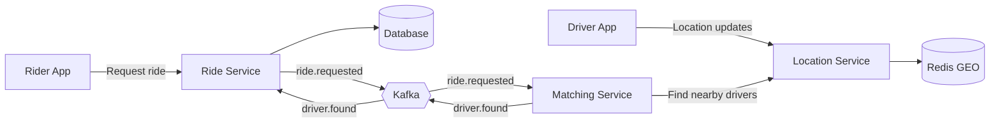

# 🚗 Uber Backend Core

A microservices-based ride-hailing backend built with **Spring Boot**, **Redis Geospatial Index**, **Kafka**, and **Docker**, inspired by how Uber matches riders with nearby drivers in real time.

> Rider requests a ride → nearby drivers found via Redis GEO → best driver matched → ride status updated → rider notified.


---

## 📑 Table of Contents

- [Overview](#-overview)
- [Features](#-features)
- [Tech Stack](#-tech-stack)
- [Why Redis Instead of SQL?](#-why-redis-instead-of-sql)
- [Architecture](#-architecture)
- [Services](#-services)
- [Ride Request Flow](#-ride-request-flow)
- [Driver Matching](#-driver-matching)
- [Getting Started](#-getting-started)
- [Configuration](#-configuration)
- [API Overview](#-api-overview)
- [Kafka Topics](#-kafka-topics)
- [Project Structure](#-project-structure)
- [Learning Resources](#-learning-resources)
- [Contributing](#-contributing)
- [License](#-license)

---

## 🔎 Overview

When you open Uber and request a ride, a driver is assigned within seconds, even though hundreds or thousands of drivers are moving around the city at that exact moment. A traditional SQL query (computing the distance from the rider to every driver row, on every request, while locations update constantly) does not hold up at that scale.

This project builds that core system from scratch:

- Driver locations are stored in a **Redis geospatial index** for fast radius searches.
- Services communicate asynchronously through **Kafka** events.
- A dedicated **matching service** picks the best nearby driver for each ride request.

---

## ✨ Features

- 📍 **Real-time driver location tracking** using Redis `GEOADD`
- 🔍 **Nearby driver search** within a given radius using Redis `GEOSEARCH`
- 📏 **Distance and position lookups** using Redis `GEODIST` and `GEOPOS`
- 🚕 **Ride requests** with status tracking across the ride lifecycle
- 💵 **Fare estimation** based on trip distance
- 🧠 **Driver matching** that selects the best driver among those nearby
- ⚡ **Event-driven** communication between services using Kafka
- 🐳 **One-command infrastructure** with Docker Compose (Zookeeper, Kafka, Redis, database)

---

## 🧰 Tech Stack

| Layer | Technology |
|---|---|
| Language / Framework | Java, Spring Boot |
| Geospatial Index | Redis (GEOADD, GEOSEARCH, GEODIST, GEOPOS) |
| Messaging | Apache Kafka (with Zookeeper) |
| Database | Relational DB for rides (via Docker Compose) |
| Containerization | Docker, Docker Compose |
| Build Tool | Maven / Gradle |

---

## ⚖️ Why Redis Instead of SQL?

| Concern | Plain SQL | Redis Geospatial |
|---|---|---|
| Location updates | Frequent writes to a disk-backed table | In-memory, very fast writes |
| Nearest-driver query | Compute distance across many rows | Index-backed radius search |
| Latency under load | Degrades as drivers grow | Stays low for real-time use |
| Fit for ephemeral data | Overkill for "where is the driver now" | Natural fit |

Redis stores driver coordinates in a sorted set using geohash encoding, so "find drivers within 5 km of this point" becomes a single, fast command.

```bash
# Store a driver's location (longitude, latitude, member)
GEOADD drivers:locations 78.4867 17.3850 driver:101

# Find drivers within 5 km of a rider
GEOSEARCH drivers:locations FROMLONLAT 78.4800 17.3900 BYRADIUS 5 km ASC WITHDIST

# Distance between two drivers, and a driver's coordinates
GEODIST drivers:locations driver:101 driver:102 km
GEOPOS drivers:locations driver:101
```

---

## 🏗 Architecture



---

## 🧩 Services

| Service | Responsibility |
|---|---|
| **location-service** | Stores driver locations in Redis and exposes nearby-driver search |
| **ride-service** | Handles ride requests, fare estimation, status updates, and publishes ride events |
| **matching-service** | Consumes ride requests, finds the best nearby driver, and publishes the result |
| **infrastructure** | Docker Compose setup for Zookeeper, Kafka, Redis, and the database |

---

## 🔄 Ride Request Flow

1. A driver app continuously sends its **location** to the location service, which stores it in Redis.
2. A rider **requests a ride** through the ride service.
3. The ride service **estimates the fare**, saves the ride, and publishes a `ride.requested` event to **Kafka**.
4. The **matching service** consumes the event and searches for **nearby drivers** within a radius.
5. The matching service **selects the best driver** and publishes a `driver.found` event.
6. The ride service **consumes the result** and updates the ride status.
7. The rider sees the assigned driver.

---

## 🎯 Driver Matching

The matching service does not simply pick the first driver it finds. It:

1. Queries the Redis GEO index for drivers within the search radius, sorted by distance.
2. Filters out drivers who are unavailable.
3. Ranks the remaining candidates and selects the best one.
4. Publishes the outcome back to Kafka so the ride service can update the ride.

---

## 🚀 Getting Started

### Prerequisites

- Java 17+
- Maven or Gradle
- Docker and Docker Compose

### 1. Clone the repository

```bash
git clone https://github.com/<your-username>/uber-backend-core.git
cd uber-backend-core
```

### 2. Start infrastructure

```bash
docker-compose up -d
```

This starts Zookeeper, Kafka, Redis, and the database.

### 3. Run the services

Start each service from its own directory:

```bash
cd location-service && ./mvnw spring-boot:run
cd ride-service && ./mvnw spring-boot:run
cd matching-service && ./mvnw spring-boot:run
```

### 4. Try it out

1. Register a few driver locations with the location service.
2. Request a ride through the ride service.
3. Watch the matching service pick a driver and the ride status update.

---

## ⚙️ Configuration

Each service has its own `application.yml` / `application.properties`. Key settings:

| Property | Description |
|---|---|
| `spring.data.redis.host` / `port` | Redis connection (location-service) |
| `spring.kafka.bootstrap-servers` | Kafka broker address |
| `spring.kafka.consumer.group-id` | Consumer group for each service |
| `spring.datasource.*` | Database connection (ride-service) |
| `server.port` | Port for each service |

> ⚠️ Never commit secrets. Use environment variables or a secrets manager.

---

## 📡 API Overview

> Endpoint paths below are illustrative. Adjust them to match your implementation.

| Service | Method | Endpoint | Description |
|---|---|---|---|
| Location | POST | `/api/locations/drivers/{driverId}` | Update a driver's location |
| Location | GET | `/api/locations/nearby` | Find drivers within a radius |
| Ride | POST | `/api/rides/request` | Request a ride |
| Ride | GET | `/api/rides/{rideId}` | Get ride details and status |
| Ride | GET | `/api/rides/estimate` | Get an estimated fare |

---

## 📨 Kafka Topics

| Topic | Producer | Consumer | Purpose |
|---|---|---|---|
| `ride.requested` | ride-service | matching-service | A rider has requested a ride |
| `driver.found` | matching-service | ride-service | A driver has been matched; update ride status |

---

## 📂 Project Structure

```
.
├── location-service/
├── ride-service/
├── matching-service/
├── docker-compose.yml
├── LICENSE
└── README.md
```

---

## 🎓 Learning Resources

This project accompanies a full video build:

- 🎥 **Video:** [Uber Real-Time Driver Matching System: Spring Boot, Redis, Kafka](https://www.youtube.com/watch?v=Cdx4DF9N8d8)
- 📚 **Playlist:** [Spring Boot Microservices Full Course](https://www.youtube.com/playlist?list=PLq2IQ7nZjFRGltba_w9oH6aLVrjmvhszx)
- 💻 **Course repo:** [SpringBoot-Microservice-Full-Course](https://github.com/YeshendraDhaker/SpringBoot-Microservice-Full-Course)
- 🚗 **Source code:** [Uber-App](https://github.com/YeshendraDhaker/Uber-App)

---

## 🤝 Contributing

Contributions are welcome!

1. Fork the repository
2. Create a feature branch (`git checkout -b feature/amazing-feature`)
3. Commit your changes (`git commit -m "Add amazing feature"`)
4. Push to the branch (`git push origin feature/amazing-feature`)
5. Open a Pull Request

---

## ⚠️ Disclaimer

This project is for **educational purposes only**. It is not affiliated with or endorsed by Uber Technologies, Inc.

---

## 📄 License

This project is licensed under the **MIT License**. See the [LICENSE](LICENSE) file for details.
